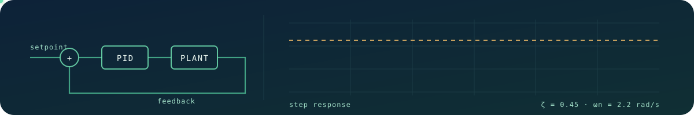

# UPID

A portable C99 PID controller for keeping a measured value near a target. Give it the target, the latest sensor reading and the time since the last reading. It returns a bounded output your application can send to a heater, motor or other actuator.



## Run the heater example

From the repository root, build and run the simulation with a C99 compiler. The example heats a simulated value from 20 toward 50 and prints the measurement and controller output over time.

```sh
cc -std=c99 -Wall -Wextra -Iinclude examples/basic_pid.c src/upid.c -lm -o basic_pid
./basic_pid
```

The final line should be close to `settled at 50.016 (setpoint 50.0)`. [Example source](examples/basic_pid.c)

## Use it in your project

1. Compile [upid.c](src/upid.c) with your project and add [upid.h](include/upid.h) to your include path. For Arduino, you can place both files beside the sketch. For ESP-IDF, add the source to a component.
2. Call `upid_cfg_init(&cfg)`. Set the output limits to your actuator's range. Set `kp` for the immediate response, `ki` to correct persistent error and `kd` to damp rapid changes. Use `UPID_REVERSE` if increasing the output lowers the measurement.
3. Call `upid_create(&pid, &cfg)` once and check for `UPID_OK`. Each cycle, call `upid_spin(&pid, setpoint, measurement, dt_s)`. On success, apply `upid_get_output(&pid)`. Supply elapsed time in **seconds**, for example 0.01 for a 10 ms interval.

For example gains, response curves in numbers and troubleshooting, see the [tuning guide](TUNING.md). The header documents the full API, including manual mode and output rate limits. [API reference](include/upid.h) · [Releases](https://github.com/JonasAtelier/upid/releases) · [MIT license](LICENSE)
